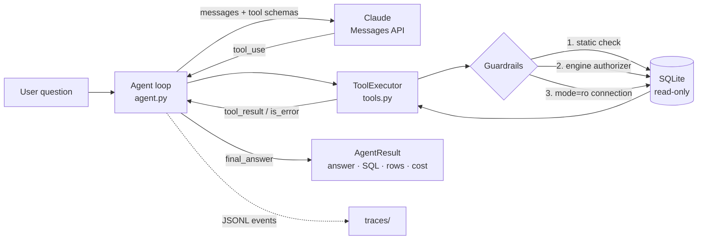

# SQL Analyst Agent

An LLM agent that answers plain-English questions about a SQL database. It explores the schema, writes SQL, runs it under read-only guardrails, fixes its own errors, and returns an answer backed by the query that produced it.

The agent loop is written by hand on the Claude Messages API, with **no agent framework**, so every step is visible and testable.

```text
$ sql-agent ask "Which sales support agent brought in the most revenue?" -v

── step 1: list_tables
── step 2: describe_tables  ['Employee', 'Customer', 'Invoice']
── step 3: run_sql  SELECT e.FirstName, e.LastName, ROUND(SUM(i.Total),2) ...

Jane Peacock generated the most revenue: $833.04 from the customers she supports.

[4 LLM calls · 3 tool calls · 9120+410 tokens · $0.0224 · 7.9s]
```
<!-- Replace with a real run + a GIF once you have one. -->

## Architecture



| Component | File | What it does |
|---|---|---|
| Agent loop | `src/sql_agent/agent.py` | Calls the model, runs tools, feeds results back. Enforces the step and error budgets and tracks tokens and cost. |
| Tools | `src/sql_agent/tools.py` | `list_tables`, `describe_tables`, `run_sql`, plus two tools that end the task: `final_answer` and `ask_clarification`. |
| Guardrails | `src/sql_agent/guardrails.py`, `db.py` | Three independent safety layers (below), plus a query timeout and a row cap. |
| Evals | `evals/` | 22 questions with known-correct SQL, scored by execution accuracy. |
| Tracing | `src/sql_agent/tracing.py` | One JSONL event per model call and tool call. |

## Key design decisions

- **Tool errors become `tool_result`s with `is_error: true`, never exceptions.** The model sees `no such column: Genre`, then calls `describe_tables` and fixes the query. Most of the agent's reliability comes from this.
- **Safety in layers, because no single check is enough:**
  1. A static check (one statement, must start with `SELECT` or `WITH`) gives the model a readable error.
  2. A SQLite authorizer callback denies any engine action that isn't a read. This catches `WITH x AS (SELECT 1) DELETE FROM ...`, which gets past layer 1 (there is a test for it).
  3. The database file is opened with `mode=ro`, so even trusted code can't write.
  4. A wall-clock timeout (via SQLite's progress handler) and a row cap stop runaway queries.
- **`final_answer` re-runs the SQL.** The rows returned to the user come from the database, not from the model's prose. If the final SQL fails, the error goes back to the model to fix.
- **Budgets:** `max_steps` and `max_consecutive_errors` stop the agent from looping forever.
- **The LLM client is injected.** Unit tests use a scripted fake client, so CI is deterministic, free, and runs without an API key.

## Quickstart

```bash
git clone https://github.com/<you>/sql-analyst-agent && cd sql-analyst-agent
python -m venv .venv && source .venv/bin/activate
pip install -e ".[dev]"
cp .env.example .env              # add your ANTHROPIC_API_KEY
python scripts/download_chinook.py

sql-agent ask "What are the top 5 genres by revenue?" -v
sql-agent chat                    # multi-turn; the agent may ask a clarifying question
pytest                            # offline unit tests
python evals/run_eval.py          # live eval (about 22 questions; a few cents on Sonnet)
```

The sample database is [Chinook](https://github.com/lerocha/chinook-database), a digital music store with 11 tables: artists, albums, tracks, customers, invoices, and employees.

## Evaluation

`evals/dataset.jsonl` has 22 questions (6 easy, 8 medium, 8 hard), each with a known-correct ("gold") query. The score is **execution accuracy**: the agent's final SQL must return the same result set as the gold SQL. Row order is ignored unless the question asks for an order. Column order is ignored, and extra columns count as a separate "superset" match type. See `src/sql_agent/evaluation.py`.

<!-- Paste the summary table printed by `python evals/run_eval.py` here, one row per model. -->

| Model | Easy | Medium | Hard | Overall | Median latency | $/question |
|---|---|---|---|---|---|---|
| claude-sonnet-5-5 | – | – | – | – | – | – |
| claude-haiku-4-5 | – | – | – | – | – | – |

## Roadmap (suggested milestones)

- [x] **M1: Core loop.** Tools, three-layer guardrails, budgets, CLI, JSONL traces, eval harness, offline tests, CI.
- [ ] **M2: Baseline numbers.** Run the eval on two models, fill in the table above, and write down three failure patterns from the traces.
- [ ] **M3: Prompt and tool iteration.** Fix those failure patterns (for example, add foreign-key hints to `describe_tables`, or return distinct values for low-cardinality columns). Re-run the eval and show before/after numbers.
- [ ] **M4: Schema retrieval for large databases.** Embed table and column descriptions, and retrieve the top-k tables instead of listing all of them. Test on a BIRD mini-dev database.
- [ ] **M5: Charts.** Add a `make_chart` tool (Plotly spec → PNG/HTML) and a Streamlit UI showing the answer, SQL, table, and chart.
- [ ] **M6: Observability and cost.** Swap the JSONL tracer for Langfuse or OpenTelemetry. Add prompt caching on the system prompt and tool definitions, and measure the cost drop.
- [ ] **M7: Postgres.** Add a Postgres backend through Docker, using a read-only role and `statement_timeout`. Add `sqlglot` to validate SQL across dialects.
- [ ] **M8: LLM-as-judge.** Grade the prose answer (faithful to the result rows?) in addition to the SQL result.

## Resume bullet (fill in your numbers after M2–M3)

> Built a tool-using text-to-SQL agent on the Claude API with a hand-written agent loop, self-correcting error recovery, and three-layer read-only guardrails (static validation, SQLite authorizer, read-only connection). Designed a 22-question execution-accuracy benchmark; improved accuracy from **X%** to **Y%** at **$Z/query** through schema-tool and prompt iteration.

## License

MIT
